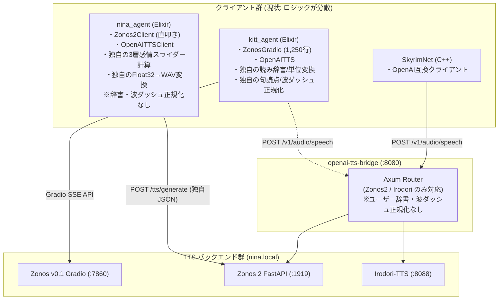
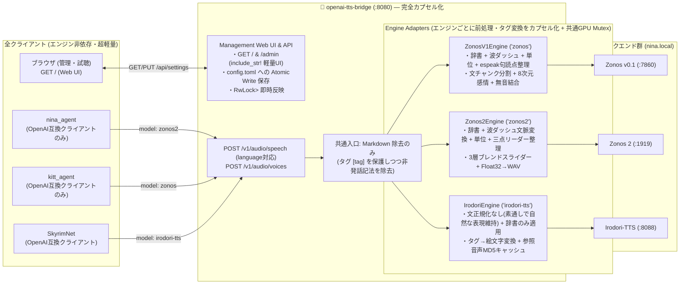

# 🎙️ Unified TTS Bridge 設計書 (v0.3 / V2 統合アーキテクチャ)

最終更新: 2026-11-15

## 1. 背景と現状の課題 (As-Is)

現在、音声合成（TTS）を取り巻くクライアント（`nina_agent`、`kitt_agent`、`SkyrimNet`）とバックエンドエンジン（`Zonos v0.1`、`Zonos 2`、`Irodori-TTS`）の接続経路および前処理ロジックが以下のように分散・重複している。



### 現状の問題点
1. **テキスト正規化・辞書処理の非統一**
   - `kitt_agent` にだけ「読み辞書（`東白川村`→`ひがししらかわむら` 等）」「単位変換（`cm`→`センチ`）」「波ダッシュ `〜`→`ー` 正規化」が存在し、`nina_agent` には入っていないため、Zonos 2 が「の〜んびり」を「のからんびり」と誤読する。
2. **感情タグ解析・音声変換ロジックの二重管理**
   - `nina_agent` の `zonos2_client.ex` と `openai-tts-bridge` の `src/parser/emotion.rs` の両方に「3層感情スライダー計算」と「Float32 PCM → Int16 WAV 変換」が二重実装されている。
3. **Zonos v0.1（Kitt用）が Bridge 未対応**
   - `kitt_agent` が Zonos v0.1 Gradio（`:7860`）を使うために `zonos_gradio.ex`（約1,250行）を抱え続けている。
4. **設定管理の煩雑さ**
   - 各エンジンURLやデフォルト設定が CLI 引数 / `systemd` 設定ファイルに散在しており、稼働中にパラメータ調整や辞書追加ができない。

---

## 2. 目指す姿：Unified Bridge アーキテクチャ (To-Be)

`openai-tts-bridge` を **唯一の音声合成ゲートウェイ** として再定義し、すべての音声エンジン依存処理（エンジン別のテキスト正規化・ユーザー辞書適用・感情タグ変換・音響パラメータ変換・WAVフォーマット変換）および設定用 Web UI を Bridge 内に完全カプセル化する。



### 設計のコア原則
1. **クライアントは「何を・どの声で・どのモデルで・何語で喋るか」だけを渡す**:
   - `POST /v1/audio/speech`（`model`, `voice`, `input`, `speed`, `language`, `speaker_audio_base64`）。
   - `model` ルーティング分離：
     - `"zonos"` / `"zonos-v0.1"` / `"zonos1"` → **Zonos v0.1 (`:7860`)**
     - `"zonos2"` / `"zonos-2"` → **Zonos 2 (`:1919`)**
     - `"irodori"` / `"irodori-tts"` → **Irodori-TTS (`:8088`)**
     - 未指定 / `"default"` / `"tts-1"` / `"tts-1-hd"` / `"gpt-4o-mini-tts"` → `config.toml` の `default_engine`
2. **文正規化も「エンジン固有のアダプター責務」として分離（部品は共有・適用判断は各エンジン）**:
   - **Irodori-TTS** は日本語の約物（`…` の余韻や `〜` のニュアンス）をネイティブに美しく発声できるため、**文正規化はデフォルト素通し**とし、固有名詞のユーザー辞書（`use_dictionary = true`）とオーディオタグ→絵文字変換のみを行う。
   - **Zonos 2 / Zonos v0.1** はそれぞれの音素変換器（英語寄り正規化器 / `espeak-ng`）の弱点を補うため、波ダッシュ文脈変換・単位変換・句読点整理を各エンジン設定に従って適用する。
   - すべてのテキスト変換は `[surprise-wa]` 等のブラケットタグを保護した上で、発話テキスト部分にのみ適用する。
3. **グローバル GPU 排他ロック**:
   - 同一 GPU (`nina.local`) 上での並行推論による VRAM スパイクを防ぐため、Bridge 全体で共有する `Arc<tokio::sync::Mutex<()>>` によりバックエンド推論呼び出しを安全に直列化する。
4. **DBレス・シングルバイナリ維持**:
   - 外部DBは使わず、**単一の TOML ファイル (`config.toml`)** で全ランタイム設定＋ユーザー辞書を管理する。

---

## 3. 設定保持・ホットリロード設計

### 3.1 設定の2層分離（Bootstrap vs Runtime）

1. **Bootstrap 設定（起動固定：CLI引数 / 環境変数のみ）**
   - 項目：`--host` (`HOST`), `--port` (`PORT`), `--log-level` (`LOG_LEVEL`), `--max-body-size-mb` (`MAX_BODY_SIZE_MB`), `--config-file` (`CONFIG_FILE`, デフォルト `./config.toml`)
2. **Runtime 設定（動的変更：`config.toml` 永続化 ＆ Web UI 管理対象）**
   - 初回起動時に指定パスの `config.toml` が存在しない場合は、CLI引数・環境変数（`ZONOS_URL`, `ZONOS_V1_URL`, `IRODORI_URL`, `DEFAULT_VOICE` 等）およびデフォルト辞書から初期設定を構築する（Web UI で保存した時点で `config.toml` が生成・更新される）。

### 3.2 単一 TOML ファイル (`config.toml`) スキーマ

共通の `[normalizer]` セクションを廃し、各 `[engines.<name>]` 内にそのエンジンで有効化する前処理フラグを持たせる。

```toml
[general]
default_engine = "zonos2"   # "zonos" | "zonos2" | "irodori"
default_voice = "nina"
default_language = "ja"

[engines.zonos]
url = "http://127.0.0.1:7860"
default_speaking_rate = 15.0
default_pitch_std = 45.0
chunk_silence_ms = 100
use_dictionary = true
fix_wave_dash = true
normalize_punctuation = true
convert_units = true

[engines.zonos2]
url = "http://127.0.0.1:1919"
default_speed = 1.15
use_dictionary = true
fix_wave_dash = true
normalize_punctuation = true
convert_units = true

[engines.irodori]
url = "http://127.0.0.1:8088"
model = "irodori-tts"
default_speed = 1.0
use_dictionary = true
fix_wave_dash = false
normalize_punctuation = false
convert_units = false

[[dictionary]]
surface = "東白川村"
reading = "ひがししらかわむら"
case_sensitive = true
enabled = true

[[dictionary]]
surface = "mBot2"
reading = "エムボットツー"
case_sensitive = false
enabled = true
```

### 3.3 Atomic Write とメモリ即時反映 (`RwLock<Arc<CompiledSettings>>`)

- **Atomic Write**: 同一ディレクトリの一時ファイル（`config.toml.tmp`）へ書き込み → `sync_all()` → `std::fs::rename()` でアトミックに置換。
- **スナップショット差し替え**:
  - `AppState` に `RwLock<Arc<CompiledSettings>>` を保持し、保存時に最長一致ソート済みの辞書マッチャーをコンパイルして差し替える。
  - Engine インスタンス内の共通 GPU `Mutex` や参照音声キャッシュ（Irodori ボイスキャッシュ・Zonos v0.1 Gradio `FileData` キャッシュ）は維持し、バックエンド URL が変更されたエンジンのみキャッシュを無効化する。

---

## 4. `openai-tts-bridge` の内部コンポーネント設計

### 4.1 組み込み管理 Web UI & API (`src/handlers/admin.rs` & `src/webui/index.html`)
- **極限までシンプル＆省バイナリサイズ**:
  - 追加クレートや `npm` は使わず、Rust 標準マクロ `include_str!("../webui/index.html")` のみで素の超軽量 HTML / CSS / Vanilla JS 1枚をバイナリに焼き込む。
- **エンドポイント**:
  - `GET /` および `GET /admin`: 管理 Web UI 画面（エンジン設定・辞書エディタ・変換プレビュー＆試聴プレイグラウンド）
  - `GET /api/settings`: 現在の `RuntimeSettings` を JSON で取得
  - `PUT /api/settings`: 設定・辞書を一括バリデーション＆保存（Atomic Write ＋ 即時反映）
  - `POST /api/preview`: 指定エンジン（`model`）と入力テキストに対する「正規化・辞書変換・タグ解析後の最終テキスト＆検出タグ＆パラメータ」のドライラン確認（音声試聴は既存の `POST /v1/audio/speech` をそのまま呼び出す）

### 4.2 共通テキスト正規化部品群 (`src/normalizer/`)
`[tag]` 形式のタグトークンを保護しながら、発話テキストセグメントに対してのみ以下の各関数を部品として提供する：
1. `strip_markdown`: `**太字**`, `*斜体*`（単語タグでないもの）, `` `コード` ``, コードブロック, Markdown リンク・画像の除去
2. `UserDictionary::apply`: `surface` 文字数降順（最長一致）での読み置換（ASCII英数字語は単語境界を考慮可能、`case_sensitive` 対応）
3. `convert_units`: `10cm`→`10センチ`, `50%`→`50パーセント`, `30km/h`→`30キロ`, `25°C`/`25℃`→`25度` 等の数値＋単位変換
4. `fix_wave_dash`: 前後が数字の `1〜2` 等は `から` に変換し、それ以外の `〜` / `～` は長音記号 `ー` に変換
5. `normalize_zonos_punctuation` / `split_zonos_v1_chunks`: 三点リーダー `…`→`、`（文末除去）、Zonos v0.1 向けの文末句点補完・文単位チャンク分割

### 4.3 3大エンジンアダプター (`src/engine/`)

| エンジン実装 | 指定 `model` 名 | バックエンド | カプセル化する固有処理 |
| :--- | :--- | :--- | :--- |
| **`ZonosV1Engine`** (新規) | `"zonos"`, `"zonos-v0.1"`, `"zonos1"` | `:7860` (Gradio) | ・エンジン設定に基づく正規化 ＋ 文チャンク分割<br/>・タグから8次元感情ベクトル＋`pitch_std`/`speaking_rate` への変換<br/>・参照音声の `/gradio_api/upload` MD5 キャッシュ＆失敗時自動再アップロード<br/>・`/gradio_api/call/generate_audio` 2ステップ SSE 通信とチャンク間無音 WAV 結合 |
| **`Zonos2Engine`** (拡張) | `"zonos2"`, `"zonos-2"` | `:1919` (FastAPI) | ・エンジン設定に基づく正規化（辞書・波ダッシュ・単位・三点リーダー）<br/>・3層ブレンド感情スライダー＆Valence/Arousal 計算<br/>・`/tts/generate` 呼び出し（`language` 対応）＋ Float32 PCM → 16-bit WAV 変換 |
| **`IrodoriEngine`** (拡張) | `"irodori-tts"`, `"irodori"` | `:8088` (FastAPI) | ・デフォルト文正規化なし（素通し）＋ ユーザー辞書適用<br/>・オーディオタグ → Irodori 絵文字へのインライン変換<br/>・参照音声 MD5 キャッシュ＆再起動時自動再登録 |
