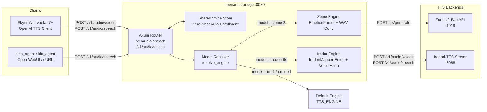

# 🦀 openai-tts-bridge

[](https://www.rust-lang.org)
[](LICENSE)

A high-performance, modular **OpenAI-compatible TTS proxy bridge** written in Rust.

It seamlessly bridges **OpenAI TTS clients** (**SkyrimNet `vbeta27+`**, `nina_agent`, `kitt_agent`, Open WebUI, AnythingLLM, etc.) with state-of-the-art local TTS engines using a plugin-based multi-engine architecture.

Supported engines:
- **Aratako Irodori-TTS** (`model: "irodori-tts"` or `"irodori"`): Expressive Japanese TTS controlled via inline Unicode style emojis (`👂`, `😮‍💨`, `🤭`, `😊`, `😡`, `😭`, `😱`, etc.).
- **Zyphra Zonos 2** (`model: "zonos2"` or `"zonos"`): High-dimensional emotion vectors, speaking-rate conditioning, and ultra-fast 32-bit float to 16-bit PCM WAV conversion.

---

## ⚡ Features

- **Dynamic Per-Request Engine Routing (No Restart Required)**:
  - Both `IrodoriEngine` and `ZonosEngine` are active simultaneously in memory.
  - Dynamically select or switch engines per request via the OpenAI `model` parameter in `POST /v1/audio/speech`:
    - `"irodori-tts"` / `"irodori"` $\rightarrow$ **Irodori-TTS**
    - `"zonos2"` / `"zonos"` $\rightarrow$ **Zonos 2**
    - `"tts-1"` / `"tts-1-hd"` / `"default"` / omitted $\rightarrow$ **Default Engine** configured via `TTS_ENGINE` (`irodori` or `zonos2`).
- **OpenAI Speech & Shared Zero-Shot Voice Enrollment API**:
  - **Speech Synthesis (`POST /v1/audio/speech`)**: Standard OpenAI TTS JSON payload (`model`, `input`, `voice`, `speed`, `response_format`) plus optional `speaker_audio_base64`.
  - **Shared Zero-Shot Voice Enrollment (`POST /v1/audio/voices`)**: Supports SkyrimNet `OpenAICompatibleTTSInterface` automatic multipart voice uploading (`ref_audio`, `title` / `voice_id`, `ref_text`) and automatic re-enrollment recovery (`HTTP 404` with `error.code = "voice_not_found"`). Enrolled reference `.wav` voices are stored in a shared in-memory store and can be used across **both Irodori-TTS and Zonos 2** without re-uploading when switching models.
  - **Models & Health (`GET /v1/models`, `GET /health`)**: Exposes all available engine models (`irodori-tts`, `irodori`, `zonos2`, `tts-1`, `tts-1-hd`) and concurrent health status for both backends.
- **Full SkyrimNet `vbeta27+` Audio & Emotion Tag Support (138+ Tags)**:
  - Supports all **138 tags** from SkyrimNet's `carry_tags_*.yaml` (`emotion`, `inflection`, `pacing`, `vocal_quality`, `volume`, `nonverbal`), legacy `0650_audio_tags.prompt` tags, and Higgs-style tags.
  - Automatically strips `<SE>` / `</SE>` sound-effect wrappers generated by LLMs.
  - Automatically repairs broken LLM tag outputs (such as missing opening brackets like `chuckle] Hello` or punctuation-split tags like `[whisper。]`).
  - **Irodori Engine (`model: "irodori-tts"`)**: Translates tags inline into all 36 official Aratako Irodori-TTS-500M-v2 style emojis (`👂`, `😮‍💨`, `🤭`, `😆`, `😊`, `😡`, `😭`, `😱`, `😒`, `🥱`, `🤧`, `🌬️`, `⏸️`, `⏩`, `🐢`, `📢`, `📉`, `📈`, `🤖`, `💪`, `🙏`, `👑`, `😎`, `🧸`, etc.).
  - **Zonos 2 Engine (`model: "zonos2"`)**: Extracts tags into clean text and maps them to multidimensional emotion sliders (`happy`, `sad`, `angry`, `surprised`, `fear`, `disgust`), CFG scale, and speaking rate multipliers.
- **Ultra-Fast Audio Conversion**:
  - Converts Zonos 2's raw 32-bit IEEE float PCM stream into standard 16-bit integer PCM WAV (`RIFF WAVE`, 44.1kHz, Mono) in memory with `< 1ms` overhead.

---

## 🏗️ Architecture



---

## 🎭 Audio & Emotion Tag Mapping

Both `[tag]`, `(tag)`, and `*tag*` notations (as well as `<SE>[tag]</SE>`) are supported:

| Category | Representative Tags (`carry_tags_*.yaml` & Legacy) | Irodori Emoji | Zonos 2 Mapping |
| :--- | :--- | :---: | :--- |
| **Whisper / Secret** | `whisper`, `whispering`, `conspiratorial`, `hushed`, `murmur`, `mutter`, `under breath` | `👂` | `speed: 0.85`, `happy: 0.2`, `cfg: 1.3` |
| **Sigh / Relief** | `sigh`, `exhale`, `relieved`, `resigned`, `tired`, `exhausted`, `world-weary`, `defeated` | `😮‍💨` | `sad: 0.6`, `speed: 0.9`, `cfg: 1.5` |
| **Chuckle / Teasing** | `chuckle`, `giggle`, `snicker`, `smirk`, `playfully`, `teasing`, `coy`, `wry`, `sly`, `amused` | `🤭` | `happy: 0.7`, `cfg: 1.5` |
| **Laugh / Cackle** | `laugh`, `laughter`, `cackle`, `guffaw`, `cheerful`, `jovial`, `gleeful`, `ecstatic` | `😆` | `happy: 0.85`, `cfg: 1.6` |
| **Happy / Warm** | `happy`, `warm`, `warmly`, `gentle`, `softly`, `tender`, `affectionate`, `loving`, `kindly`, `smiling` | `😊` | `happy: 0.6`, `speed: 0.92`, `cfg: 1.4` |
| **Angry / Hostile** | `angry`, `furious`, `hostile`, `enraged`, `snarl`, `growl`, `seething`, `bitter`, `threatening`, `stern` | `😡` | `angry: 0.8`, `speed: 1.05`, `cfg: 1.6` |
| **Sad / Crying** | `sad`, `cry`, `sob`, `weep`, `sniffle`, `whimper`, `heartbroken`, `grief`, `mournful`, `hurt`, `remorseful` | `😭` / `😢` | `sad: 0.8`, `speed: 0.88`, `cfg: 1.6` |
| **Fear / Panic** | `scared`, `fearful`, `terrified`, `panicked`, `trembling`, `shaky`, `scream`, `shriek`, `anxious`, `nervous` | `😱` / `😨` | `fear: 0.8`, `surprised: 0.4`, `speed: 1.1`, `cfg: 1.6` |
| **Surprise / Gasp** | `surprised`, `shocked`, `amazed`, `astonished`, `stunned`, `gasp`, `startled`, `incredulous` | `😲` | `surprised: 0.8`, `cfg: 1.5` |
| **Disgust / Scorn** | `disgusted`, `scoff`, `sneer`, `contemptuous`, `disdainful`, `repulsed`, `dismissive`, `patronizing` | `😒` / `🤢` | `disgust: 0.8`, `angry: 0.3`, `cfg: 1.5` |
| **Groan / Yawn** | `groan`, `grunt`, `strain`, `pain`, `wounded` / `yawn`, `sleepy`, `drowsy`, `bored` | `😩` / `🥱` | `sad: 0.5`, `disgust: 0.4` / `speed: 0.82` |
| **Cough / Sneeze** | `cough`, `clearing throat`, `clear throat`, `sneeze`, `hiccup`, `choke` | `🤧` | Removed from spoken text |
| **Breath / Pant** | `pant`, `inhale`, `breath`, `deep breath`, `breathless`, `out of breath`, `winded`, `raspy`, `hoarse` | `🌬️` / `😮` | `fear: 0.3`, `speed: 1.15` |
| **Pacing / Speed** | `slow`, `slowly`, `deliberate`, `measured`, `hesitant`, `uncertain` / `fast`, `rushed`, `urgent`, `hurried` | `🐢` / `⏩` / `⏸️` | `speed: 0.82` / `speed: 1.18` |
| **Volume / Tone** | `shouting`, `yelling`, `loud`, `booming`, `bellowing` / `quiet`, `faint` / `monotone`, `deadpan`, `flat` | `📢` / `🤖` / `📉` / `📈` | Mapped to intensity & rate |
| **Character / Role** | `proud`, `regal`, `haughty`, `commanding` / `confident`, `smug` / `pleading`, `begging`, `desperate` | `👑` / `😎` / `🙏` / `💪` | Mapped to corresponding emotions |

---

## 🛠️ Configuration

All options can be configured via CLI arguments or environment variables (or a `.env` file):

| CLI Flag | Env Variable | Default | Description |
| :--- | :--- | :--- | :--- |
| `--tts-engine` | `TTS_ENGINE` | `zonos2` | Default backend engine when `model` is omitted or generic (`tts-1`): `zonos2` or `irodori` |
| `--host` | `HOST` | `0.0.0.0` | Bind address |
| `--port` | `PORT` | `8000` | Listen port |
| `--zonos-url` | `ZONOS_URL` | `http://127.0.0.1:1919` | Zonos 2 FastAPI server base URL |
| `--irodori-url` | `IRODORI_URL` | `http://127.0.0.1:8088` | Irodori-TTS-Server base URL |
| `--irodori-model` | `IRODORI_MODEL` | `irodori-tts` | Model identifier sent to Irodori-TTS |
| `--default-voice` | `DEFAULT_VOICE` | `default` | Fallback speaker/voice ID when none is provided |
| `--default-model` | `DEFAULT_MODEL` | `zonos2` | Default model name for Zonos 2 |
| `--default-speed` | `DEFAULT_SPEED` | `1.15` | Base speech speed multiplier (used by Zonos 2) |
| `--max-body-size-mb` | `MAX_BODY_SIZE_MB` | `100` | Max HTTP request payload size in MB |
| `--log-level` | `LOG_LEVEL` | `info` | Log level (`error`, `warn`, `info`, `debug`, `trace`) |

---

## 🚀 Quick Start

### 1. Build from Source

```bash
git clone git@github.com:kjsd/openai-tts-bridge.git
cd openai-tts-bridge
cargo build --release
```

The optimized binary will be produced at `target/release/openai-tts-bridge`.

### 2. Run the Multi-Engine Bridge

```bash
TTS_ENGINE=irodori \
IRODORI_URL=http://127.0.0.1:8088 \
ZONOS_URL=http://127.0.0.1:1919 \
DEFAULT_VOICE=default \
./target/release/openai-tts-bridge
```

---

## 🖥️ Running as a systemd Service (Linux)

To run `openai-tts-bridge` as a background daemon on a Linux server:

1. Create a service file at `/etc/systemd/system/openai-tts-bridge.service`:

```ini
[Unit]
Description=OpenAI-Compatible TTS Bridge Server
After=network.target

[Service]
Type=simple
User=minoru
WorkingDirectory=/home/minoru/work/openai-tts-bridge
ExecStart=/home/minoru/work/openai-tts-bridge/target/release/openai-tts-bridge
Restart=always
RestartSec=3
Environment=HOST=0.0.0.0
Environment=PORT=8080
Environment=TTS_ENGINE=irodori
Environment=IRODORI_URL=http://127.0.0.1:8088
Environment=ZONOS_URL=http://127.0.0.1:1919
Environment=DEFAULT_VOICE=default
Environment=DEFAULT_SPEED=1.15
Environment=LOG_LEVEL=info

[Install]
WantedBy=multi-user.target
```

2. Enable and start the service:

```bash
sudo systemctl daemon-reload
sudo systemctl enable --now openai-tts-bridge
```

3. Check logs:

```bash
journalctl -u openai-tts-bridge -f
```

---

## 📡 Client Setup & Integration

### 1. SkyrimNet (`vbeta27+` OpenAI-Compatible TTS)

In SkyrimNet configuration:
- **TTS Method**: `OpenAI TTS` (`openai`)
- **Endpoint URL**: `http://<server-ip>:8080/v1/audio/speech`
- **Model**:
  - Set `irodori-tts` (or `irodori`) to synthesize with **Irodori-TTS**
  - Set `zonos2` (or `zonos`) to synthesize with **Zonos 2**
  - You can switch between `irodori-tts` and `zonos2` anytime in the SkyrimNet UI (or per-character override) without restarting `openai-tts-bridge`!
- **Service Profile**: `self_hosted` (skips unnecessary reference audio STT)
- **Zero-Shot Voice Cloning**: SkyrimNet automatically uploads local NPC `.wav` files (such as `femaleeventoned.wav` or custom voices) to `POST /v1/audio/voices` and synthesizes speech via `POST /v1/audio/speech` with `snv1-<sha256>` / `voice:<editorId>` voice IDs. If `openai-tts-bridge` restarts, it responds with `404 voice_not_found`, and SkyrimNet automatically re-enrolls the `.wav` on the fly.

### 2. Standard OpenAI Client (cURL)

```bash
# 1. Optional: Enroll a custom zero-shot reference voice (shared across both engines)
curl -X POST http://localhost:8080/v1/audio/voices \
  -F "title=snv1-mycustomvoice" \
  -F "ref_audio=@/path/to/sample.wav;type=audio/wav"

# 2a. Synthesize speech using Irodori-TTS
curl -X POST http://localhost:8080/v1/audio/speech \
  -H "Content-Type: application/json" \
  -d '{
    "model": "irodori-tts",
    "input": "[conspiratorial] パパ、寒くない？ [sigh]",
    "voice": "snv1-mycustomvoice",
    "response_format": "wav"
  }' \
  --output speech_irodori.wav

# 2b. Synthesize speech using Zonos 2 (no restart or voice re-upload needed!)
curl -X POST http://localhost:8080/v1/audio/speech \
  -H "Content-Type: application/json" \
  -d '{
    "model": "zonos2",
    "input": "[playfully] こっちはZonos 2の声だよ！",
    "voice": "snv1-mycustomvoice",
    "response_format": "wav"
  }' \
  --output speech_zonos2.wav
```

### 3. Health & Models API

```bash
# Health check (includes per-engine status for both irodori and zonos2)
curl http://localhost:8080/health

# List available models
curl http://localhost:8080/v1/models
```

---

## 🧪 Testing

Run all unit tests and mock integration tests:

```bash
cargo test
```

Includes comprehensive tests for:
- Float32 to PCM16 WAV audio conversion and header validation.
- Emotion parser and malformed tag recovery (missing brackets, punctuation split anomalies, `<SE>` wrapper stripping).
- Irodori emoji mapper conversions covering all 36 official styles and 138+ SkyrimNet `carry_tags_*.yaml` tags.
- SkyrimNet OpenAI-compatible zero-shot voice enrollment (`POST /v1/audio/voices`) and automatic `404 voice_not_found` re-enrollment flows for both Irodori and Zonos 2.
- Dynamic runtime engine switching (`model: "irodori-tts"` $\leftrightarrow$ `model: "zonos2"`) with shared zero-shot reference voices.

---

## 📄 License

MIT License.
